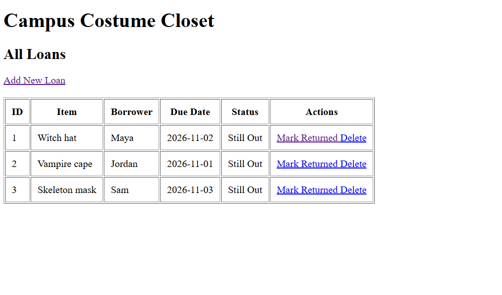
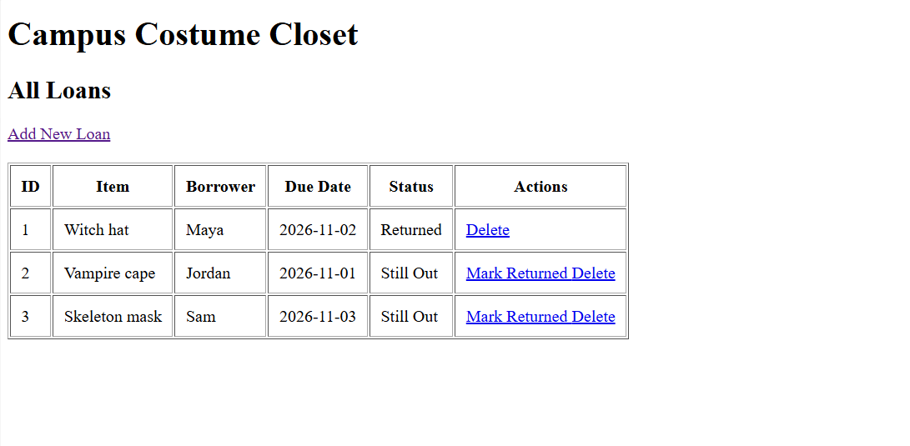

# SE250 Lab 8 - Campus Costume Closet

## Student Names
- Student 1: [Khaled Shaheen]

## Project Description
This project is a simple web application for managing costume loans on campus. It allows users to track borrowed costumes and their return status.

## Technologies Used
- HTML
- PHP
- MySQL
- XAMPP
- GitHub

## Features
- Add new costume loans.
- View all borrowed costumes.
- Mark costumes as returned.
- Delete loan records.
- Validate form inputs.
- Display a message when no loans exist.

## How to Run
1. Install and open XAMPP.
2. Start Apache and MySQL.
3. Place the project folder inside the XAMPP htdocs directory.
4. Open phpMyAdmin.
5. Create a database named costume_closet.
6. Import costume_closet.sql.
7. Open list.php through localhost.

## Screenshots

### Loan List

### Returned Loan
